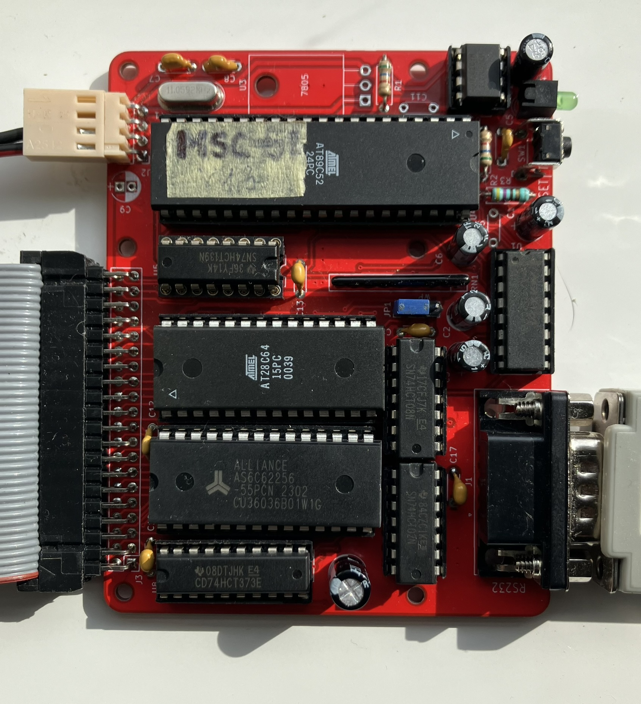

# MSC-51 mini 8052 BASIC single board computer 
This is a single board computer with Intel 8052 microcontioller, which runs special version of Microsoft BASIC.

This board actually work with Atmel AT8952 chip, has a 32KB of RAM and 8KB of flash memory for permanent program storage.

In the documentation folder there is a schematic in pdf and also the original Intel datasheet for specialized chip 8052AH-BASIC, which has a prewritten code to run BASIC.
